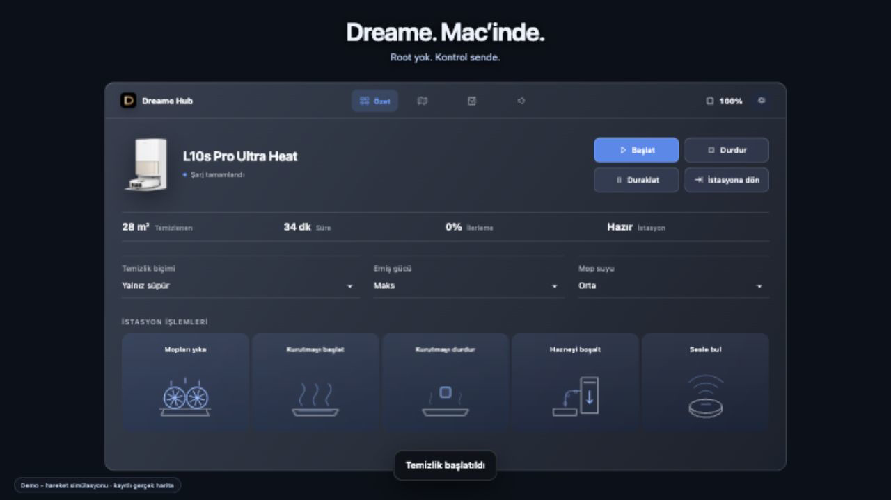
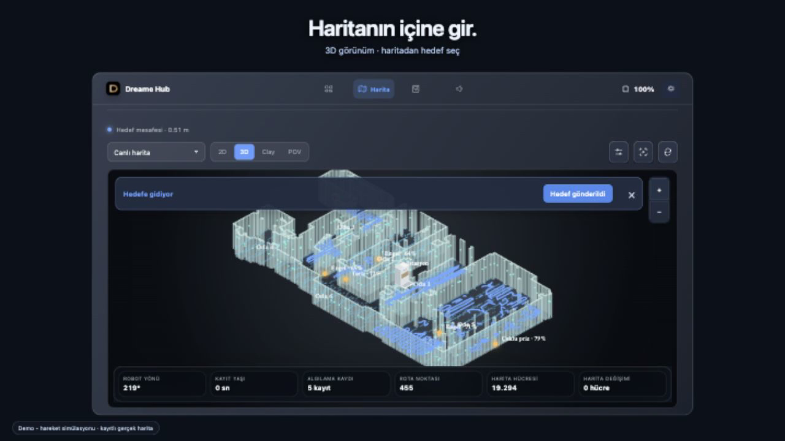
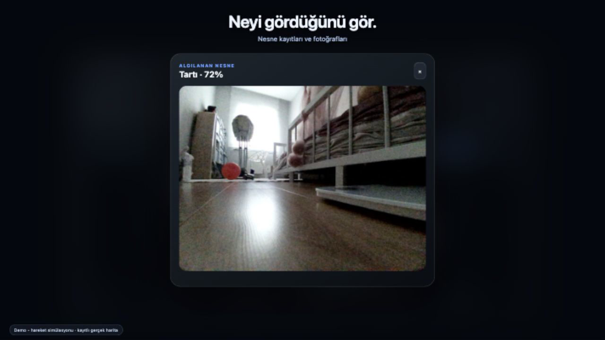
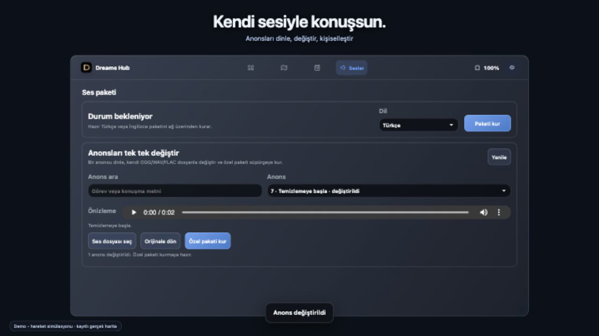

# Dreame Hub

### Your Dreame. At home on your Mac.

[Türkçe](README.tr.md) · English

Control your robot, explore its map and see what it found — from a compact macOS menu-bar panel. **No rooting the robot. No Python runtime.** Built with Swift, with the established interface preserved in Apple's WKWebView.



## A cleaner view of cleaning

**One click from your menu bar.** Check battery and cleaning progress, choose suction and mop settings, then start, pause, stop or send your robot home. Station shortcuts keep washing, drying and emptying close at hand.

**Your home, from a different angle.** Zoom, rotate and explore the 3D map. Review previous cleans, inspect the recorded route or choose a target on the map. Robot movement eases between received positions and directions, then stops at the latest observation — no invented movement when updates stop.



**See what your robot noticed.** Open recorded object detections and available photos directly from the map. Availability depends on the robot and the saved record.



**Give your robot a voice.** Browse announcements, preview them on your Mac and prepare custom sound replacements. Keep track of brushes, filters and station maintenance in the same app.



## Watch it in use

[Desktop walkthrough · landscape](docs/media/actual-ui-landscape.mp4) · [Mobile-friendly walkthrough · portrait](docs/media/actual-ui-portrait.mp4)

These 30-second demos show the actual interface, map zoom and orbit, wall controls, route trails, map points, wireframe, 2D/3D/Clay/POV views, object photos and voice customization, with an original electronic soundtrack. Robot movement is simulated for filming; the physical robot was not operated.

## Get started

Requires an Apple Silicon Mac, macOS 13 or later and a Dreame account. Sign in, select your robot and open Dreame Hub from its menu-bar icon. Saved credentials stay in macOS Keychain.

For a source build, install a compatible Swift toolchain and run:

```sh
bash build-app.sh
open "build/Dreame Hub Swift.app"
```

For inspection without issuing robot commands, append `--args --read-only` to the launch command. Custom audio conversion uses an optional local libsndfile installation; see [build details](docs/BUILD.md).

## Models

The model catalog includes **L10s Pro Ultra Heat, L20 Ultra, L40/L40s Ultra, L50 Ultra, L60 Ultra, X40/X50/X60 Ultra, Matrix10, Aqua10, D20 and D30 variants**. [Full model list and feature coverage](docs/SUPPORTED-MODELS.md).

<sub>This Swift preview was checked read-only on one L10s Pro Ultra Heat. Physical commands and moving-robot latency are not yet live-verified in Swift. The 3D view is a perspective of the real 2D map, not raw 3D LiDAR or a camera feed. [Verification details](docs/VERIFICATION.md).</sub>

---

Independent, unofficial software; not affiliated with Dreame or Apple. Product capabilities vary by model. The source package uses neutral artwork; promotional recordings show the private app's actual interface. [Third-party notices](THIRD_PARTY_NOTICES.md) · [MIT license](LICENSE).
