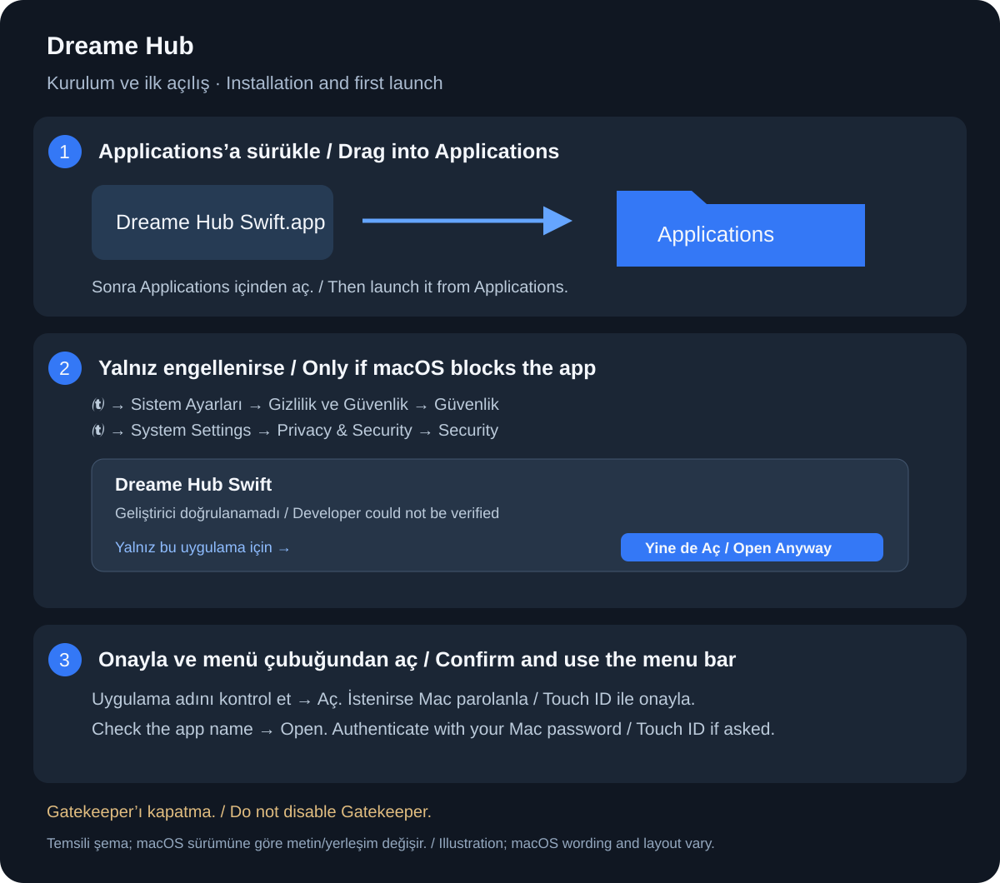

# Kurulum / Installation

## Türkçe

1. DMG’yi yalnız [resmî proje Releases sayfasından](https://github.com/retoucheroz/dreamehub/releases) indir. Apple Silicon (M1 ve sonrası), macOS 13+ gerekir; Intel paketi değildir.
2. DMG’yi açıp **Dreame Hub Swift.app** dosyasını **Applications / Uygulamalar** klasörüne sürükle. Uygulamayı bu klasörden bir kez açmayı dene.
3. Geliştirici doğrulanamadığı için engellenirse ve dosyanın kaynağına güveniyorsan ** → Sistem Ayarları → Gizlilik ve Güvenlik** bölümünde aşağıdaki **Güvenlik → Yine de Aç** düğmesini kullan. Düğme, açma denemesinden sonra görünür; gerekirse yeniden açmayı dene. macOS sürümüne göre düğmenin adı farklı görünebilir.
4. Açılan uyarıda uygulama adını kontrol edip **Aç** ile onayla. İstenirse Touch ID veya Mac parolanı kullan; bu, Dreame hesap parolan değildir. Ardından uygulama menü çubuğundaki ikonundan açılır.

**Neden uyarı var?** Bu önizleme ad-hoc imzalıdır; Apple Developer ID / noter onayı yoktur. Apple uygulamanın güvenli olduğunu doğrulamış değildir. Yalnız kaynağına güvendiğin dosyayı aç. **Gatekeeper veya SIP’yi kapatma; karantina kaldırma komutları çalıştırma.** “Bilgisayarınıza zarar verecek”, zararlı yazılım veya hasarlı dosya uyarısını bu adımlarla geçmeye çalışma; dur, yeniden resmî kaynaktan indir ve sürümdeki SHA256SUMS.txt ile bütünlüğünü kontrol et. Kurumsal Mac’lerde onay BT yöneticisine bağlı olabilir.

**Diğer izinler:** Normal kullanım için Erişilebilirlik, Ekran Kaydı veya Tam Disk Erişimi istemiyoruz. Kayıtlı hesabına erişirken Anahtar Zinciri onayı çıkarsa uygulama adını kontrol et. Özel ses paketi aktarımında yerel ağ bağlantısı gerekebilir; böyle bir macOS istemi yalnız bu işlevi kullanırken anlamlıdır. Temel kontrol için Homebrew gerekmez; özel ses dönüştürme libsndfile ister. [Derleme ve bağımlılıklar](BUILD.md).

Girişte robot görünmüyor veya hesap reddediliyorsa: [Ülke / sunucu bölgesi rehberi](LOGIN-REGIONS.md).

Kaynak: [Apple — Mac’inizde uygulamaları güvenle açma](https://support.apple.com/tr-tr/102445). Şema gerçek sistem ekran görüntüsü değildir.

## English

1. Download the DMG only from [this project's Releases page](https://github.com/retoucheroz/dreamehub/releases). Requires Apple Silicon (M1 or later), macOS 13+; this is not an Intel build.
2. Open it and drag **Dreame Hub Swift.app** into **Applications**. Try launching it from Applications once.
3. If macOS blocks it because the developer cannot be verified, and you trust the source, open ** → System Settings → Privacy & Security → Security → Open Anyway**. The app-specific option appears after an attempted launch. Names/layout may differ by macOS version.
4. Check the app name, confirm **Open**, and authenticate with Touch ID or your Mac password if requested. This is not your Dreame password. Use the app's menu-bar icon afterward.

This preview is ad-hoc signed, without Apple Developer ID/notarization. Apple has not verified its safety. **Do not disable Gatekeeper or SIP or remove quarantine using terminal commands.** Do not override malware, “will damage your computer”, or damaged-file alerts; stop, obtain a fresh official download and check it against SHA256SUMS.txt. Managed Macs may require IT approval.

Normal use does not require Accessibility, Screen Recording or Full Disk Access. Check the app name if Keychain requests access to saved credentials. Local network access may be needed for custom voice-package transfer. Basic controls do not require Homebrew; optional audio conversion uses libsndfile. [Dependencies](BUILD.md) · [Login and server regions](LOGIN-REGIONS.md).

Source: [Apple — Safely open apps on your Mac](https://support.apple.com/en-us/102445). The diagram is an illustration, not a system screenshot.
